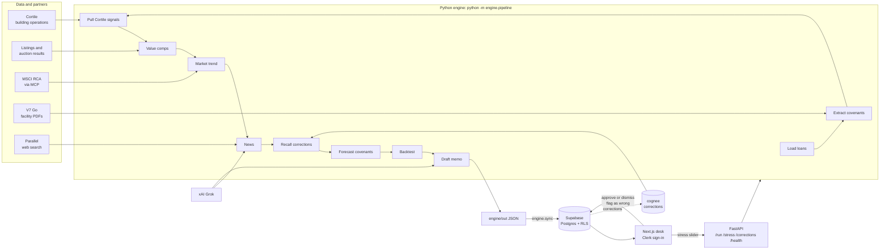

<h1 align="center">Canary</h1>

<p align="center"><b>A smoke alarm for property loans.</b><br/>
It spots broken loan rules months before the quarterly report, with proof from the buildings themselves. Twelve loans, six data and AI partners, and a human who signs off every draft.</p>

<p align="center">
  <a href="#run-it-locally">Run it locally</a> ·
  <a href="docs/ARCHITECTURE.md">Architecture</a> ·
  <a href="docs/DEMO.md">Demo script</a> ·
  <a href="#demo">Demo</a>
</p>

Built in one day at the Grok Bot Real Estate Hackathon, 12 November 2026. Track 1: workflows (lending deal to draft memo).

---

## The problem

A lender finds out a property loan is in trouble from the quarterly covenant test. That test runs on a pack the borrower sends late. By then the rent has already stopped covering the interest, or the value has already slipped. The lender hears about it months after the building did.

The building tells you sooner. Arrears climb. The service charge overspends. A fire-safety check goes overdue. Emergency repairs pile up. Flats stay empty. None of that is in the borrower pack, but all of it is in the building's operations data.

Canary reads that data every month, forecasts the loan's covenants 3 and 6 months ahead, and tells the analyst which loans to chase first.

### What a covenant is

A covenant is a rule in the loan agreement. The two that matter here:

| | |
|---|---|
| **ICR** (interest cover ratio) | Rental income after costs, divided by the interest due. A limit of 1.25x means income must be at least 1.25 times the interest. |
| **LTV** (loan to value) | The loan divided by the property's value. A limit of 65% means the loan must stay at or under 65% of value. |

Each loan has two lines. Cross the **cash trap** line and the lender holds back cash (amber). Cross the **default** line and the loan is in breach (red).

### Who it is for

- **Credit and asset-management teams** at lenders. They get a ranked watchlist and a draft memo instead of waiting for the quarterly pack.
- **Loan servicers and special servicers.** They get a reason to ask the borrower for documents earlier, with the evidence attached.
- **Risk and audit.** Every number links to a source row, listing, news URL or contract clause, and every step has an owner and a time.

## What Canary does

| | |
|---|---|
| **A monthly signal per loan** | Rolls up building data (arrears, service-charge overspend, overdue fire and electrical checks, emergency and repeat repairs, vacancy, cladding status) into one series per loan. Every signal cites the table and row ids it came from. |
| **A forecast, with a range** | Projects interest cover (ICR), loan to value (LTV) and occupancy 3 and 6 months ahead, with a low-mid-high band. Each loan is green, amber (cash trap) or red (breach). |
| **A "what if" slider** | Move interest rates up and property values down and watch the whole book re-forecast. 12 loans go from 4 red, 2 amber, 6 green to 9 red, 3 amber, 0 green at +100bp and -10% values. |
| **Proof for every number** | Click a number and see the Cortile rows, the rent and sale comparables, the market-trend factor, the news URL or the contract clause behind it. A knowledge graph shows "how we got here". |
| **Terms read from the contract** | V7 Go reads the covenant levels out of the facility-agreement PDFs. Nobody types them in. |
| **News that moves the forecast** | Parallel searches for news on each borrower, operator and tenant. A material hit changes one forecast input, through a fixed table. It is cited by URL. |
| **Drafts, not decisions** | Grok drafts the watchlist memo and a chase letter per red loan. The analyst approves or dismisses. Nothing is ever sent. |
| **A memory for corrections** | Flag a signal as "not a concern" or "wrong" and cognee remembers. The next run ignores that signal for that loan. |
| **An accuracy check** | A backtest forecasts from data cut at 2026-05-31 and scores the result against the real state on 2026-11-12. |

## Demo path

1. `/` is the landing page. Sign in with Clerk.
2. `/desk` is the summary of the book: 4 red, 2 amber, 6 green.
3. `/desk/dashboard` has the stress slider. Try +100bp rates and -10% values.
4. `/desk/loan/[id]` is the deep dive on a loan. Tabs: Overview, Forecast, Why (knowledge graph), Evidence, News, Contract.
5. `/desk/memo` has the Grok memo and chase letters, with approve and dismiss.
6. `/desk/log` shows who did what and when, plus the backtest score.

## How Canary works

Canary is a plain Python pipeline, a Supabase database, and a Next.js desk. The engine does all the maths. Models read documents and write drafts. They never produce a number that ends up in a forecast.



### The pipeline, step by step

Each step is logged to the `steps` table with an owner and a status: `done`, `fallback`, `failed` or `waiting`. If a service fails, the step falls back and the run still finishes.

| # | Step | Owner or tool | What it does | If it fails |
|---|---|---|---|---|
| 1 | Load loans | Canary engine | Builds 12 loans on real Cortile developments (5 BTR, 2 PBSA, 2 BTL, 3 commercial). Terms are synthetic. | None needed. Deterministic. |
| 2 | Extract covenants | V7 Go | Reads ICR minimum, cash trap, LTV maximum and test type from each facility PDF, with citations. | Local `pypdf` + regex reads the same clauses. Then hand-typed terms. |
| 3 | Pull Cortile signals | Canary engine | Rolls building data into monthly signals per loan, Jan 2025 to Nov 2026. 266 rows, 9 kinds. | Reads the local SQLite. No live fallback. |
| 4 | Value comps | Canary engine | Finds rent and sale comparables by postcode district and type. Median with spread. Cites listing and result ids. 33 summaries, 4,466 comps. | None needed. Local files. |
| 5 | Market trend | MSCI RCA (derived) | Turns the sector price trend into one value factor per loan. | UK House Price Index for residential. Then flat (factor 1.0). |
| 6 | News | Parallel + Grok | Searches news on borrowers, operators and tenants. Grok labels severity. Material items change one input. | No news. The forecast runs without it. |
| 7 | Recall corrections | cognee | Loads past analyst corrections so those signals are ignored for that loan. | Reads the `corrections` table in Supabase. |
| 8 | Forecast covenants | Canary engine | Plain Python. ICR, LTV and occupancy, now and at 3 and 6 months, with a range. | None needed. Pure functions. |
| 9 | Backtest score | Canary engine | Forecasts from 2026-05-31 data, scores against 2026-11-12. | Step is marked `failed`. The run continues. |
| 10 | Draft memo | Grok | Writes the watchlist memo and a chase letter per red loan from the forecast JSON only. | A template memo with no model, marked as such. |
| 11 | Await sign-off | The analyst | Drafts wait for approve or dismiss. | Not applicable. A person must act. |

Then `engine.sync` writes the run to Supabase. If sync fails, the files in `engine/out/` and `web/public/data/` still carry the run. The desk reads Supabase first, then those files, then `web/fixtures/` (synthetic sample data, labelled).

### The forecast maths

No model does any of this. It is plain Python in `engine/forecast.py`, tested against the worked example in `LOAN_RULES.md`.

```
NOI   = gross rent x occupancy
        - operating costs
        - service-charge overspend the landlord must fund
        - emergency and repeat repair cost
        - leaseholder arrears
ICR   = NOI / interest
Value = comps value x market factor x (1 - compliance haircut)
LTV   = loan / value
```

- **Status.** Red if the forecast crosses the default limit anywhere in the next 6 months. Amber if it only crosses the cash trap. Green otherwise.
- **Range.** A straight-line fit on the last 6 months of each series, projected 3 and 6 months. The low and high lines are an 80% band from the spread of the fit.
- **Market factor.** Half of the trailing 12-month sector price move, clamped between 0.85 and 1.10. Deliberately damped.
- **Compliance haircut on value.** 5% for a building with external-wall remediation, 2% per overdue fire-risk or safety-case item, capped at 15%. These percentages are illustrative.
- **News.** A fixed table maps a label and severity to a change. For example, operator distress at high severity takes 10 points off occupancy. The model picks the label. It never picks the number.
- **BTL loans** are tested at a stressed 5.5% rate, as a lender would.
- **Stress.** `stress(rate_bps, value_pct)` re-runs the same forecast with the rate moved up and the value moved down. The slider calls it through FastAPI.

More detail, including every fallback and the data contract, is in [`docs/ARCHITECTURE.md`](docs/ARCHITECTURE.md).

## Accuracy

Backtest: forecast using data only up to **2026-05-31**, then compare with the actual covenant state at **2026-11-12**.

| Result | Count |
|---|---|
| Caught (flagged early, and it happened) | 4 |
| Missed | 1 |
| False alarms | 0 |
| Loans scored | 12 |

"Caught" means the loan was forecast amber or red in May and is amber or red now. Of the 4 caught, 2 are red and 2 are amber. The one miss was forecast green and is amber on LTV today. 11 of 12 loans had exactly the right colour.

Caveats:

- Cortile has no history for occupancy, arrears or cladding status. The backtest reads those from the latest snapshot. Repair tickets, compliance due dates and service-charge years are cut at the date.
- Twelve loans is a small sample. Treat the score as a sanity check, not proof.
- The loan terms are synthetic, so "breach" means breach of a covenant we set.

## How Canary uses each tool and partner

Every row says what the tool does for Canary and what happens when it is missing.

| Tool | What it does in Canary |
|---|---|
| **Cortile** (hackathon partner) | Building operations data: buildings, units, leases and arrears, repair tickets (including emergency and reopened), fire-safety and compliance due dates, service-charge budgets, and external-wall (EWS) cladding status. This is the early-warning signal. Read from the local SQLite. |
| **Listings and auction results** | Rent and sale comparables. Let listings set the income. Sale listings and achieved auction prices set the value. 4,466 comps are cited across the book. |
| **MSCI Real Capital Analytics (RCA), via MCP** | Sector price-trend data, used to move each loan's value and so its LTV. Only the derived factor is stored and shown, labelled "MSCI RCA". Raw MSCI data never enters the repo. |
| **V7 Go** | A workflow that reads the facility-agreement PDFs and extracts the covenant terms (ICR minimum, cash trap, LTV maximum, test type) with citations. Fallback: `pypdf` and regex. |
| **Parallel (web search)** | Live news on borrowers, operators, tenants and cities. Three queries per loan, cached. Grok labels each hit. Material items change a forecast input and are cited by URL. |
| **xAI Grok (grok-4.7)** | Writes the watchlist memo and chase letters as drafts. Every number in a draft is checked against the data. If a draft uses a number it was not given, it is rewritten once, then rejected. Also labels news severity. Groq is used for testing only. |
| **cognee** | Memory for analyst corrections ("not a concern", "flagged as wrong"). Recalled at the start of every run. The matching signal is ignored for that loan. |
| **Supabase** (Postgres + RLS) | The contract between the engine and the web. Anyone can read. The desk can only update draft decisions and insert corrections and log steps. Only the engine, with the service key, writes forecasts. |
| **Clerk** | Sign-in for the desk. |
| **Next.js, Tailwind, shadcn/ui, Motion, recharts, react-force-graph** | The web desk: pages, charts, the stress slider and the "how we got here" knowledge graph. |
| **FastAPI** | `POST /run` (re-run the pipeline), `GET /stress` (the slider), `POST /corrections` (store a correction in cognee and Supabase), `GET /health`. If the engine is not running, the slider falls back to an approximate calculation in the browser and says so. |
| **Cursor, with Claude models** | Used to build it. |
| **Grok Bot** | The in-app LLM. It is the only model that writes text a user sees. |

### What is real and what is synthetic

| Item | Status |
|---|---|
| Buildings, units, arrears, service charges, compliance, repair tickets (Cortile) | **Real** partner data |
| Rent and value comparables (listings, auction results) | **Real**, public pages crawled by the organisers |
| Market value trend (MSCI RCA) | **Real**, licensed. Derived factor only |
| Borrower, operator and tenant news (Parallel) | **Real**, cited by URL |
| Covenant extraction from PDFs (V7 Go) | **Real** extraction run |
| Memo and chase letters (Grok) | **Real** model output, drafts only |
| Loan terms: amounts, rates, covenant levels, borrower names | **Synthetic**, set from published market levels (see `LOAN_RULES.md`) |
| The 3 facility agreements in `engine/contracts/` | **Synthetic**, labelled as such |
| Sample data in `web/fixtures/` | **Synthetic**. Used only if no live data is available |

No real loan book is public. So the 12 loans sit on real Cortile developments, but the terms are ours. Everything a loan points at is real.

## Who owns each step

Canary assists. A person decides.

- Each step in the log has an **owner**: the Canary engine, a named partner tool, or the analyst.
- The last step, "Await analyst sign-off", is always owned by the analyst and always waits.
- The analyst can **approve** or **dismiss** each draft, and **flag** any signal as "not a concern" or "wrong". Each action is logged with the name and time.
- Draft status can be `draft`, `approved` or `dismissed`. There is no `sent`. Canary has no way to send anything.
- A correction teaches the next run. It does not rewrite history.

## Safety by design

- **The model does no maths.** Forecasts are plain Python. A model only writes text from numbers it is given.
- **Drafts are number-checked.** Any figure in a memo or letter that is not in the source JSON triggers a rewrite, then a rejection and the template fallback.
- **Fixed news effects.** The model labels news. A table in code decides how much it moves a forecast.
- **Steps fail soft.** A failed service shows as `fallback` in the log. It never hides.
- **Synthetic is labelled.** Loan terms and contracts say so on the screen.
- **No secrets in the repo.** `.env`, `data/` and `msci_private/` are git-ignored.

## Tech

Python 3 (pandas, numpy, pypdf, httpx) · FastAPI · Next.js 16 (App Router) · TypeScript · Tailwind 4 · shadcn/ui · Motion · recharts · react-force-graph-2d · Clerk · Supabase (Postgres, RLS) ·
**Cortile** (building data) · **MSCI RCA** (market trend) · **V7 Go** (contract extraction) · **Parallel** (news search) · **xAI Grok** (drafts and news labels) · **cognee** (memory) · Groq (testing only).

## Project structure

```
README.md            this file
LOAN_RULES.md        covenant levels and the worked example, with sources
DATA.md              every data source, what is in it, how Canary uses it
requirements.txt     engine dependencies
.env.example         engine key names (no values)
docs/                SPEC.md (data contract), DEMO.md (video script), ARCHITECTURE.md
mockup/              the design mockup the desk follows
engine/
  pipeline.py        runs every step, logs each, writes JSON, syncs
  loans.py           builds the 12 loans
  signals.py         monthly signals from Cortile
  values.py          rent and value from listings and auctions
  market.py          MSCI-derived value factor (UK HPI, then flat, as fallback)
  extract.py         V7 Go covenant extraction (pypdf fallback)
  news.py            Parallel search and Grok labelling
  forecast.py        ICR, LTV, occupancy, status, drivers, stress
  backtest.py        cut at 2026-05-31, score at 2026-11-12
  memo.py            Grok memo and chase letters, number-checked
  memory.py          cognee corrections
  llm.py             xAI or Groq client
  sync.py            engine/out JSON to Supabase
  api.py             FastAPI
  contracts/         3 synthetic facility agreements (PDF)
  test_forecast.py   checks the worked example
web/
  src/app/           landing, sign-in, and desk/ (summary, dashboard, loan/[id], memo, log)
  src/components/    charts, knowledge graph, evidence table, memo decision
  src/lib/           data.ts (Supabase, then files, then fixtures), calc, types
  fixtures/          synthetic sample data
```

## Run it locally

The web app runs with no keys. It falls back to the synthetic sample data in `web/fixtures/`.

```powershell
# Engine (needs Cortile data in data/, see below)
pip install -r requirements.txt -r requirements-integrations.txt
copy .env.example .env          # then fill in your own keys
python -m engine.pipeline --backtest
python -m engine.sync           # push results to Supabase
uvicorn engine.api:app --port 8000

# Web
cd web
npm install
npm run dev                     # http://localhost:3000
```

Web environment (`web/.env.local`): `NEXT_PUBLIC_SUPABASE_URL`, `NEXT_PUBLIC_SUPABASE_ANON_KEY` and `NEXT_PUBLIC_ENGINE_URL` (for example `http://localhost:8000`). Clerk keys (`NEXT_PUBLIC_CLERK_PUBLISHABLE_KEY` and `CLERK_SECRET_KEY`) are optional in development. Without them the desk opens in demo mode with no sign-in.

Engine keys are listed by name in `.env.example`: xAI or Groq (`LLM_PROVIDER`), Parallel, V7, cognee and Supabase.

The engine reads Cortile and listings data from `data/` and MSCI figures from `msci_private/`. Neither is in this repo, so only hackathon attendees with access can re-run the full pipeline. Pass `--no-llm` to skip news and the model-written memo.

Tests: `python -m engine.test_forecast` (checks the worked example in `LOAN_RULES.md`).

## Demo

The 2-minute video script is in [`docs/DEMO.md`](docs/DEMO.md). The video is uploaded with our hackathon submission. It shows:

1. The landing page and the problem, then sign-in.
2. The summary: 4 red, 2 amber, 6 green.
3. The stress slider moving the book to 9 red, 3 amber, 0 green.
4. A red loan: the forecast chart, the knowledge graph, the evidence table, the contract terms read by V7 Go and the news that moved the forecast.
5. The Grok memo and a chase letter, then the analyst's approval.
6. The step log and the backtest score.

## Data-use notice

MSCI and Cortile data are not in this repository and are not republished. MSCI figures appear only as derived, labelled values and will be deleted after judging. Cortile data was provided to hackathon attendees for this event only. Loan terms and facility PDFs are synthetic. No `.env` file or key is committed.

## Team

Ibad Zuberi ([@Ibad-10](https://github.com/Ibad-10)).
