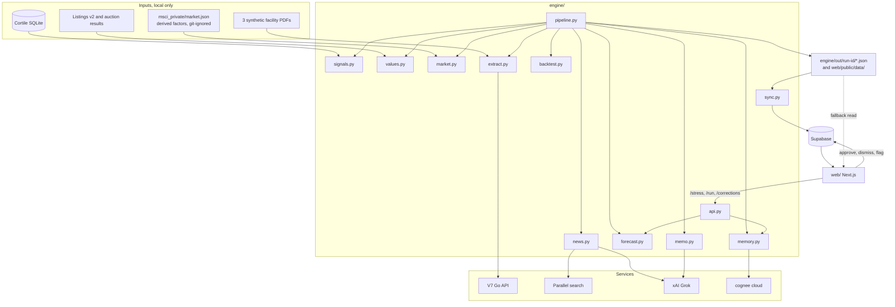

# Canary architecture

The short version is in the [README](../README.md). This page has the detail: data flow, the data contract, the forecast maths, every fallback, and how each partner is wired in.

## 1. Principles

1. **The engine does the maths.** Forecasts are pure Python functions. Models read documents and write text.
2. **Every number has a source.** Signals cite Cortile table and row ids. Comps cite listing or result ids. News cites a URL. Contract terms cite the file.
3. **Steps fail soft.** Each integration is imported lazily inside a try block. A failure becomes a `fallback` row in the step log and the run finishes.
4. **Humans sign off.** Drafts have status `draft`, `approved` or `dismissed`. No code path sends anything.
5. **Real data, synthetic terms.** Everything a loan points at is real partner or public data. Only the loan terms and the 3 facility PDFs are synthetic, and they are labelled.

## 2. Data flow



## 3. The run

`python -m engine.pipeline [--backtest] [--no-llm]` runs 11 steps. A run id looks like `run-20261112-2148`.

| # | Step | Owner | Module | Fallback |
|---|---|---|---|---|
| 1 | Load loans | Canary engine | `loans.py` | none, deterministic |
| 2 | Extract covenants | V7 Go | `extract.py` | `pypdf` + regex on the same PDF, then hand-typed terms |
| 3 | Pull Cortile signals | Canary engine | `signals.py` | none, local SQLite |
| 4 | Value comps | Canary engine | `values.py` | none, local files |
| 5 | Market trend | Canary engine | `market.py` | MSCI-derived factor, then UK HPI (residential only), then flat 1.0 |
| 6 | News | Grok | `news.py` | no news; step marked `fallback` |
| 7 | Recall corrections | cognee | `memory.py` | the Supabase `corrections` table |
| 8 | Forecast covenants | Canary engine | `forecast.py` | none, pure functions |
| 9 | Backtest score | Canary engine | `backtest.py` | step marked `failed`, run continues |
| 10 | Draft memo | Grok | `memo.py` | template memo and letters, marked `template` |
| 11 | Await analyst sign-off | the analyst | web | always waits |

After step 11 the engine writes `engine/out/<run_id>/*.json`, copies the same files to `engine/out/latest/` and `web/public/data/`, then calls `engine.sync` to push them to Supabase.

### Step notes

- **Load loans.** 12 loans on real Cortile developments: 5 build-to-rent, 2 student accommodation, 2 buy-to-let portfolios, 3 commercial (office, retail, logistics). The book is a fixed development-id list (`FIXED_BOOK`) so selection does not depend on post-cutoff vacancy or tickets. Amounts are sized so the starting LTV sits between 55% and 65% and the ICR has headroom at origination (BTL sizing uses the PRA 5.5% stress rate; ongoing ICR uses the contractual rate). Covenant levels come from `LOAN_RULES.md`.
- **Extract covenants.** V7 Go gets one project, a file property and a JSON property with a fixed schema (`icr_min`, `icr_cash_trap`, `ltv_max`, `ltv_cash_trap`, `test`). The engine uploads the PDF, polls for the result and checks all four numbers are present. Project ids are cached locally.
- **Signals.** Nine signal kinds: arrears, service-charge overspend, compliance overdue, compliance missing, external-wall remediation, higher-risk building, emergency tickets, reopened tickets, vacancy. Each row stores `{dataset, table, row_ids, count}`.
- **Comps.** Rent per unit from let listings, value per unit from sale listings and achieved auction prices, matched on postcode district and then city, by property type. Median with spread.
- **Market trend.** `market.py` reads derived figures only. The factor is `1 + 0.5 x trailing 12-month change`, clamped to 0.85-1.10.
- **News.** Up to 3 queries per loan (borrower, sector operator in the city, sector tenant in the city), up to 3 hits each. Grok labels each hit as `operator_distress`, `tenant_loss`, `refinancing_risk`, `regulatory_action` or `irrelevant`, with a severity. Results are cached. Only items that name the borrower, operator or tenant can be `high`.
- **Corrections.** Recall reads cognee first and the Supabase `corrections` table second. Only if both fail does the step fall back.
- **Memo.** Grok gets the forecast JSON and a list of citation ids (for example `L03/D1`). Every number in its output must appear in that JSON. A draft that fails the check is sent back once, then rejected.

## 4. Forecast maths

All of this is in `engine/forecast.py`. The live desk uses a **hybrid** model; a straight-line trend is kept as fallback and as a "challenger" that can only worsen colour.

```
NOI   = gross rent x occupancy
        - operating costs (share of gross rent, by sector)
        - service-charge overspend not recovered
        - emergency and reopened repair cost
        - arrears annual drag
ICR   = NOI / (loan x contractual rate)
Value = comps value x market factor x (1 - haircut) x (1 + news value change)
LTV   = 100 x loan / Value
```

### Hybrid method (default)

Three layers, then 1000 Monte Carlo draws; bands are p10 / p50 / p90; status reads the p50 path.

1. **Dated events** — lease expiries, fire-risk / safety-case due dates, service-charge year ends, repair costs rolling out of the trailing 12-month window, and news from the month it was published. Each event moves cash flow or value in the month it happens (with an estimated probability where needed).
2. **Drift** — AutoETS on monthly repair spend (AutoARIMA fallback; recent mean if history is short). Residential occupancy is a **persistent two-state Markov** per unit (monthly move-out / let-up); move-out is ILLUSTRATIVE (~25%/yr PRS turnover in `OCC_MOVE_OUT_MONTHLY`), let-up is set so the steady state matches observed occupancy. Bands therefore widen with horizon.
3. **Challenger** — the previous straight-line 6-month trend. If it crosses a cash-trap or default level the hybrid median does not, the loan takes the worse colour and a driver explains why.

| Item | Rule |
|---|---|
| Operating costs | Share of gross rent: BTR 25%, PBSA 30%, BTL 0% (tested on gross rent), commercial 10%. Illustrative. |
| Ongoing test rate | The contractual loan rate for every sector. |
| BTL stress (5.5%) | PRA SS13/16 origination affordability only (`origination_rate` in loan sizing). Not used for ongoing ICR. |
| Arrears | Cortile stores a **balance**. Annual ICR drag = `ARREARS_WRITEOFF_PCT` (default 25%) × borrower-attributable balance. Borrower's share of other leaseholders' arrears = service-charge share (never 100% just because freehold). No 12-month change is available — Cortile has no arrears history. |
| Haircut | 5% if any building has external-wall remediation, plus 2% per overdue fire-risk or safety-case item, capped at 15%. Illustrative. |
| Linear fallback | Straight-line fit over the last 6 months; band `mid +/- 1.28 x spread x sqrt(h)`. Used if the hybrid raises, and as the challenger. |
| Status | For each metric, walk the path from now to +6 months. Red if it crosses the default limit. Amber if it only crosses the cash trap. The loan takes the worst metric. |
| First breach | The earliest month any metric crosses the default limit, with the metric named. |
| `breach_kind` | `covenant` when ICR or occupancy drives the colour; `valuation_risk` when LTV does (modelled value, not a formal valuation). `null` when green. |
| Occupancy | Also tested where the covenant has an occupancy minimum. |
| Suppression | A correction removes one signal kind for one loan. That signal then adds nothing to NOI, haircut or occupancy. |
| Stress | Rate up by `rate_bps`, base value moved by `value_pct`, then the same forecast. |
| Drivers | Each move from underwriting to now (and forward dated events) with effect text and signal/evidence ids. Sorted by size. |

### News effects (fixed table)

| Label | Metric | Low | Medium | High |
|---|---|---|---|---|
| Operator distress | Occupancy | -2 | -5 | -10 |
| Tenant loss | Rent | -3 | -7 | -15 |
| Regulatory action | Value | -1 | -3 | -6 |
| Refinancing risk | Value | -1 | -2 | -4 |

Units are percent for rent and value, and percentage points for occupancy.

### Backtest (point-in-time)

`backtest.py` forecasts with inputs cut at **2026-05-31**, then scores against **observed** covenant colours on November inputs (2026-11-12).

**Point-in-time rules**

- Tickets, compliance due dates and final service-charge years: only records dated `<=` cutoff.
- Snapshot-only fields (occupancy, arrears, EWS status, higher-risk, compliance `no_record`) have no Cortile history. At the cutoff they are **excluded** — not filled from the November extract. The forecast then uses underwritten occupancy (with Markov churn around that mean, so bands still widen) and zero arrears/EWS haircut.
- The 12-loan book is a **fixed development-id list** (`loans.FIXED_BOOK`), independent of post-cutoff vacancy or tickets.
- News is switched off in the backtest.

**Actual (ground truth)**

`actual` = `observed_covenant` on November inputs: the same ICR/LTV/occupancy formulae applied to observed inputs only — **no forecast path**. This is **model-derived ground truth**, not an independent market outturn. Field: `actual_definition = "observed_covenant_november_inputs_no_forecast"`.

**Baselines and scoring** (written into `runs.score`)

| Field | Meaning |
|---|---|
| `model` / `persistence` | Side-by-side blocks with `n_loans`, `n_events`, `caught`, `missed`, `false_alarms`, `clear`, `exact_colour`, `exact_colour_accuracy`, `recall`, `recall_wilson_95` `{low,high}` |
| Top-level `caught` / `missed` / `false_alarms` / `exact_status` | Legacy copies of the **model** block (UI keep-working) |
| `persistence` | Colour at the cutoff persists through November |
| `band_coverage` | Share of actual ICR/LTV/occupancy inside the cutoff forecast's p10–p90 at the November horizon month |
| `per_loan[]` | Per loan: `predicted`, `persistence`, `actual`, `result`, `persistence_result`, predicted/actual metrics |

| Result | Meaning |
|---|---|
| Caught | Forecast (or persistence) was amber or red, and November observed is amber or red |
| Missed | Green at cutoff prediction, November observed amber or red |
| False alarm | Amber or red predicted, November observed green |
| Clear | Green in both |

## 5. Data contract (Supabase)

The engine writes, the web reads. These tables are the whole interface. Full column list in [`SPEC.md`](SPEC.md).

| Table | Holds |
|---|---|
| `runs` | One row per run: mode (`live` or `backtest`), as-of date, model used, backtest score |
| `loans` | The 12 loans, terms and covenants (synthetic) |
| `signals` | Monthly signals with a `source` pointer to the rows behind them |
| `forecasts` | Status, breach metric and month, metrics with bands, drivers |
| `evidence` | Comps, market trend, news, with labels like "MSCI RCA" (derived only) |
| `steps` | The log: step, owner, status, detail, times |
| `drafts` | Memo and chase letters with status `draft`, `approved` or `dismissed` |
| `corrections` | Analyst corrections that the next run recalls |

**Row-level security** is on for every table. Per the spec: the anon key can read everything, update only the decision columns on `drafts`, and insert into `corrections` and `steps`. The service-role key writes forecasts and runs and lives only in the engine's `.env`.

## 6. The web desk

Next.js App Router, TypeScript, Tailwind 4, shadcn/ui, Motion, recharts, `react-force-graph-2d`.

| Route | Shows |
|---|---|
| `/` | Landing page: the problem, the partner steps, sign-in |
| `/sign-in`, `/sign-up` | Clerk |
| `/desk` | Summary of the book: red, amber and green counts and the loans to look at first |
| `/desk/dashboard` | Filters, sector chart, ICR and LTV charts, the stress slider |
| `/desk/loan/[id]` | Tabs: Overview, Forecast, Why (knowledge graph), Evidence, News, Contract |
| `/desk/memo` | Watchlist memo and chase letters, approve or dismiss |
| `/desk/log` | Who did what and when, plus the backtest score |

Reading data (`web/src/lib/data.ts`): Supabase with the anon key, else `web/public/data/*.json` from the engine, else `web/fixtures/*.json` (synthetic sample, shown with a "Sample data" label). With `CANARY_DATA=demo` it reads only `web/demo-data/*.json` (see section 10).

Writing from the browser: approve or dismiss updates `drafts` and adds a `steps` row. "Flag as wrong" and "not a concern" insert into `corrections`.

Stress slider: calls `GET {NEXT_PUBLIC_ENGINE_URL}/stress`. If the engine is not reachable, it computes an approximation in the browser and says so on screen.

Auth: Clerk protects `/desk` when `NEXT_PUBLIC_CLERK_PUBLISHABLE_KEY` is set. Without it the desk opens in demo mode so the app always starts.

## 7. FastAPI

`engine/api.py`. CORS allows `http://localhost:3000`.

| Endpoint | Does |
|---|---|
| `GET /health` | `{"ok": true}` |
| `POST /run?backtest=` | Runs the full pipeline (up to 15 minutes), returns the run id |
| `GET /stress?rate_bps=&value_pct=` | Re-forecasts all loans from cached inputs and returns the new counts |
| `POST /corrections` | Stores a correction in cognee and in the Supabase `corrections` table. Fails only if both fail. |

## 8. Models

`engine/llm.py` is an OpenAI-compatible client. `LLM_PROVIDER=xai` (default) uses xAI and picks the highest `grok-N.M` model the key can see. The latest run used `grok-4.7`. `LLM_PROVIDER=groq` is for testing. Temperature is 0.2. Models are used for three things only: labelling news, writing the memo, and writing chase letters.

## 9. Secrets and data

- Engine key names are in `.env.example`. Values are never committed.
- `.env`, `data/`, `msci_private/`, `engine/out/` and `engine/cache/` are git-ignored.
- MSCI data is used in-app only and deleted after judging. Cortile data is for attendees of this event only.

## 10. Public demo (Vercel)

The public site never talks to Supabase (it holds MSCI rows). It reads a sanitised snapshot instead: production has `CANARY_DATA=demo` and no Supabase variables, so `data.ts` loads `web/demo-data/*.json`, the header pill says "Real run, anonymised" and sign-off, dismiss and "flag as wrong" are disabled.

`engine/publish.py` builds the snapshot from `engine/out/latest/`: it drops MSCI evidence rows and market drivers, replaces MSCI/RCA and Cortile mentions in text, swaps loan, borrower and building names, addresses and postcodes for stable pseudonyms, and hashes source row ids. The mapping and its salt stay in `engine/cache/publish_map.json` (git-ignored, not deployed). A leak check fails the run if any original name, id, postcode, "MSCI", "RCA" or "Cortile" survives.

`web/demo-data/` is git-ignored but not in `web/.vercelignore`, so the CLI uploads it. Redeploy after a new run:

```powershell
cd D:\canary-hack; python -m engine.publish
cd web; vercel deploy --prod --yes
```
